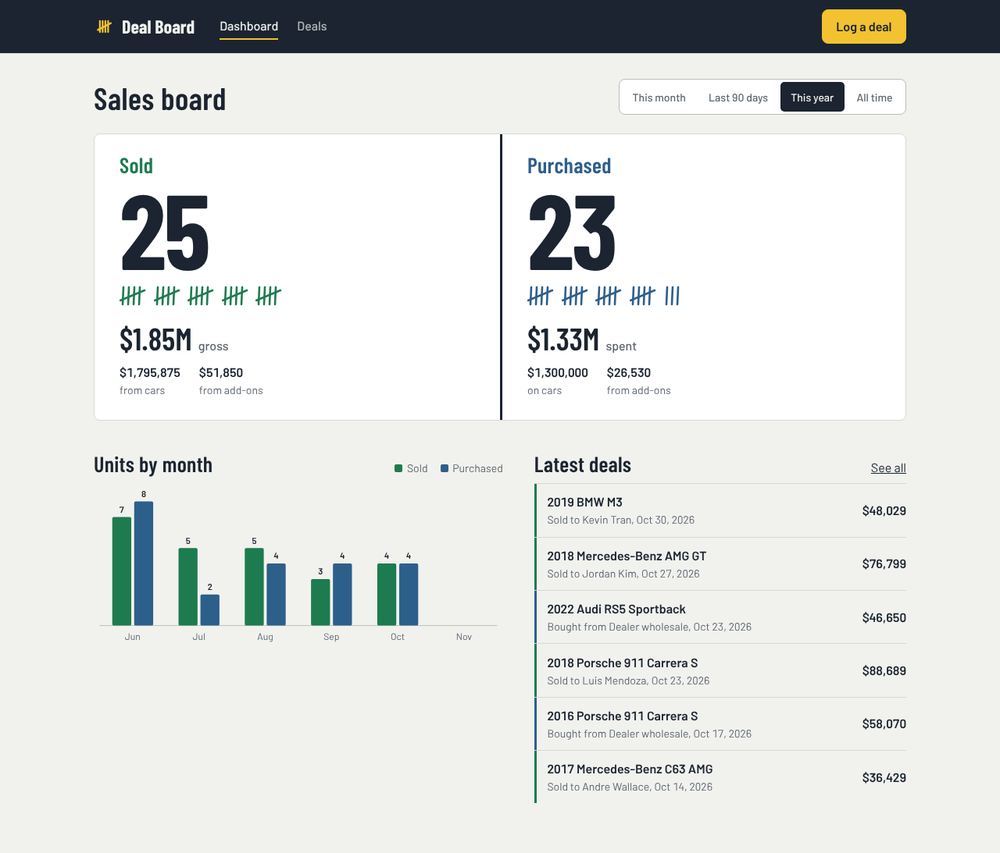
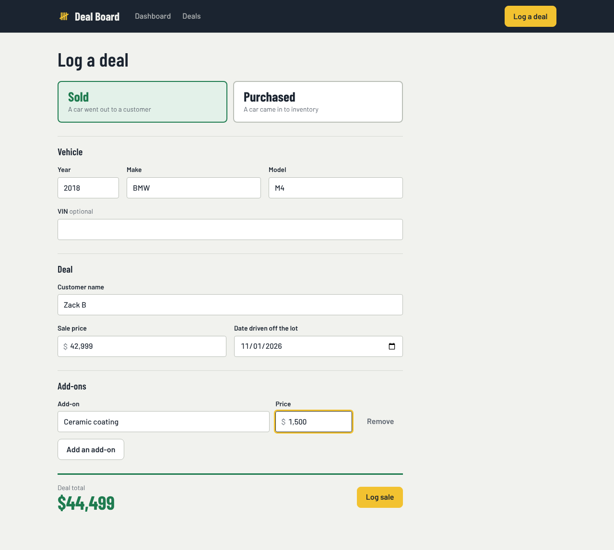
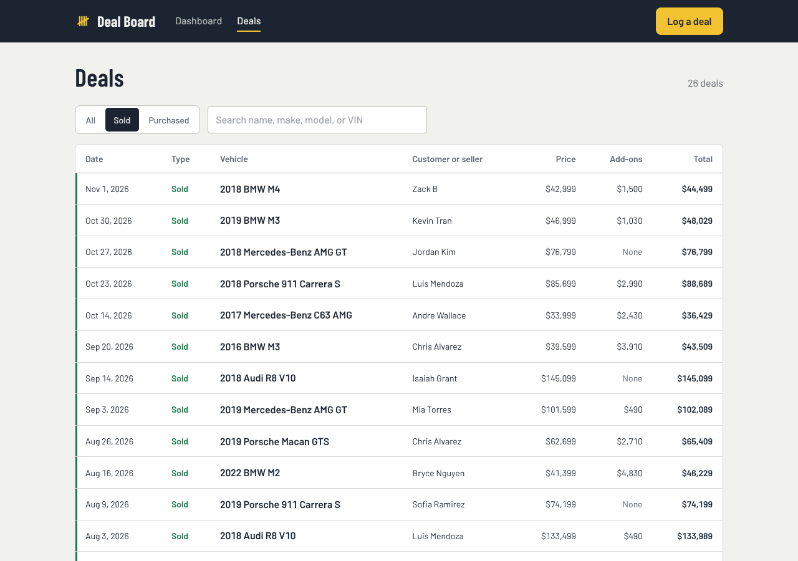
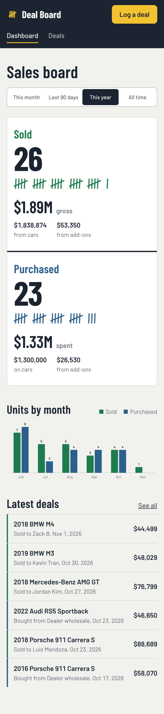

# Deal Board

A full-stack REST app for car salespeople to log every vehicle they **sell** and every vehicle they **purchase** for inventory, with a live sales board that totals units and gross.

I built it from my own time selling used luxury cars, where deals got tracked in notes apps and texts. Deal Board replaces that with one form and one dashboard.



## Features

- **Sales board.** Units sold and purchased, gross dollars, and the split between vehicle price and add-ons, filterable by this month, last 90 days, this year, or all time.
- **One form for both directions.** A Sold / Purchased toggle relabels the form ("Customer name" becomes "Bought from", "Date driven off the lot" becomes "Date acquired").
- **Add-ons.** Add as many line items as you need (ceramic coating, warranty, transport, auction fees) and see the deal total update live.
- **Deal history.** Search by name, make, model, or VIN. Filter by type and page through results. Filters live in the URL, so a filtered view can be bookmarked.
- **Edit and delete** any deal. The dashboard updates right away.
- Responsive down to phone width, with light and dark themes.

| Log a deal | Deals | Mobile |
|---|---|---|
|  |  |  |

## Tech stack

| Layer | Tools |
|---|---|
| Frontend | React 19, TypeScript, Vite, React Router, TanStack Query, CSS Modules |
| Backend | Node.js, Express 5, TypeScript, Zod |
| Database | PostgreSQL 16, Drizzle ORM and migrations |
| Testing | Vitest, Supertest (integration tests run against a real Postgres) |
| Tooling | ESLint, GitHub Actions CI, Docker Compose |

## Architecture

```
React (Vite) ──fetch──▶ Express API ──Drizzle──▶ PostgreSQL
                         /api/v1
                         routes → controllers → services → db
```

- **Routes** map URLs to controllers and nothing else.
- **Controllers** validate input with Zod, call a service, and shape the HTTP response.
- **Services** hold the business logic and talk to the database. They know nothing about HTTP.

### Design decisions

- **One `transactions` table with a `type` enum** instead of separate sold and purchased tables. The UI toggle maps directly to that column, and the dashboard is a single grouped query.
- **Money is stored as integer cents.** Floating-point dollars cause rounding errors. The frontend parses typed prices like `42,999` straight into cents without going through floats.
- **Add-ons live in their own table** with a cascade delete. On update, the add-on list is replaced inside a database transaction, so a deal never ends up half saved.
- **The stats endpoint uses `GROUPING SETS`** to return grand totals and the monthly breakdown in one round trip. Add-ons are pre-aggregated per deal so a car with three add-ons still counts as one unit.
- **`app.ts` is separate from `server.ts`,** so tests import the app without opening a port.
- **API versioning** under `/api/v1`.

## API

Base URL: `/api/v1`

| Method | Endpoint | Description |
|---|---|---|
| `GET` | `/health` | Health check |
| `GET` | `/transactions` | List deals. Query: `type`, `from`, `to`, `q`, `limit`, `offset` |
| `GET` | `/transactions/:id` | Get one deal with its add-ons |
| `POST` | `/transactions` | Create a deal (add-ons nested in the body) |
| `PATCH` | `/transactions/:id` | Update any subset of fields. Sending `addOns` replaces the list. |
| `DELETE` | `/transactions/:id` | Delete a deal |
| `GET` | `/stats/summary` | Units and gross per type, plus monthly totals. Query: `from`, `to` |

**Create a deal**

```http
POST /api/v1/transactions
Content-Type: application/json

{
  "type": "SOLD",
  "partyName": "Zack B",
  "year": 2018,
  "make": "BMW",
  "model": "M4",
  "vin": null,
  "priceCents": 4299900,
  "dealDate": "2026-01-01",
  "addOns": [{ "name": "Ceramic coating", "priceCents": 150000 }]
}
```

Returns `201 Created` with a `Location` header and `{ "data": { ...deal } }`.

**Errors** share one shape:

```json
{
  "error": {
    "code": "VALIDATION_ERROR",
    "message": "Request validation failed",
    "details": [{ "path": "year", "message": "Too small: expected number to be >=1900" }]
  }
}
```

| Status | Code | When |
|---|---|---|
| 400 | `VALIDATION_ERROR` | Body, query, or id failed validation |
| 400 | `INVALID_JSON` | Request body isn't valid JSON |
| 404 | `NOT_FOUND` | No deal with that id |
| 404 | `ROUTE_NOT_FOUND` | Unknown endpoint |
| 500 | `INTERNAL_ERROR` | Unexpected server error |

## Running locally

**Prerequisites:** Node 22+ and either Docker or a local PostgreSQL 16.

```bash
# 1. Start Postgres (creates the dev and test databases)
docker compose up -d

# 2. API
cd backend
cp .env.example .env
npm install
npm run db:migrate
npm run db:seed        # optional: 48 demo deals
npm run dev            # http://localhost:3000/api/v1

# 3. Web app (new terminal)
cd frontend
npm install
npm run dev            # http://localhost:5173
```

The Vite dev server proxies `/api` to the Express server, so no CORS setup is needed in development.

<details>
<summary>Using a local Postgres instead of Docker</summary>

```bash
createdb car_deal_tracker
createdb car_deal_tracker_test
```

Then set `DATABASE_URL` in `backend/.env` to match your user and password.
</details>

### Scripts

| Where | Command | What it does |
|---|---|---|
| backend | `npm run dev` | Start the API with hot reload |
| backend | `npm test` | Run unit and integration tests |
| backend | `npm run db:generate` | Create a migration after editing `src/db/schema.ts` |
| backend | `npm run db:migrate` | Apply migrations |
| backend | `npm run db:seed` | Reset the database to demo data |
| frontend | `npm run dev` | Start the web app |
| frontend | `npm test` | Run unit tests |
| both | `npm run lint` / `npm run build` | Lint / production build |

## Testing

The backend suite (29 tests) hits every endpoint through Supertest against a dedicated `car_deal_tracker_test` database, covering happy paths, validation errors, 404s, pagination, filtering, and stats math. GitHub Actions runs lint, type checks, tests, and builds for both apps on every push and pull request.

## Project structure

```
car-deal-tracker/
├── .github/workflows/ci.yml
├── docker-compose.yml
├── backend/
│   ├── drizzle/                 # generated SQL migrations
│   ├── src/
│   │   ├── config/              # env validation
│   │   ├── db/                  # schema, client, migrate, seed
│   │   ├── routes/
│   │   ├── controllers/
│   │   ├── services/
│   │   ├── validators/          # Zod schemas
│   │   ├── middleware/          # error handling
│   │   ├── app.ts
│   │   └── server.ts
│   └── tests/
│       ├── integration/
│       └── unit/
└── frontend/
    └── src/
        ├── api/                 # fetch client + endpoints
        ├── hooks/               # TanStack Query hooks
        ├── components/
        │   ├── dashboard/
        │   ├── transactions/
        │   └── layout/
        ├── pages/
        ├── types/
        └── utils/               # money + date helpers
```

## Roadmap

- User accounts, so each salesperson sees their own board
- Link a purchase to its later sale to show profit per car
- CSV export for commission reports
- Deploy (API on Render or Railway, web app on Vercel, managed Postgres)

## License

MIT
